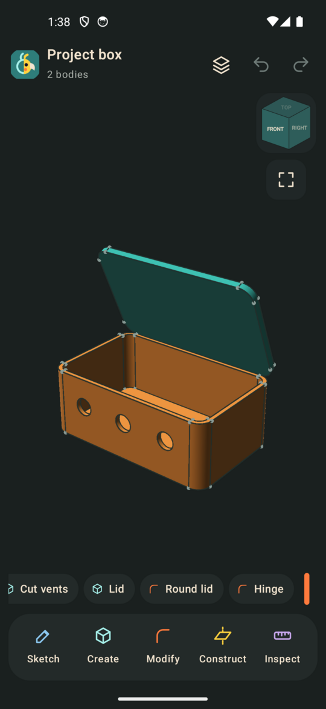
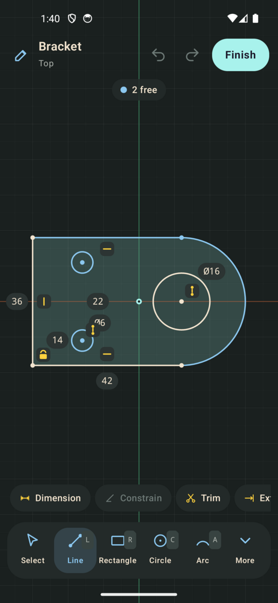
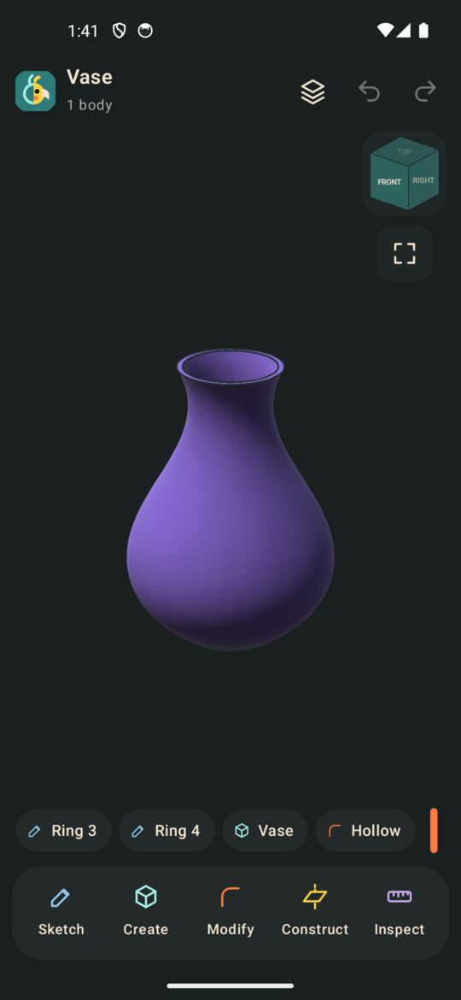
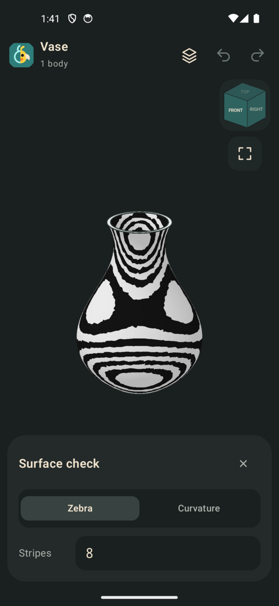
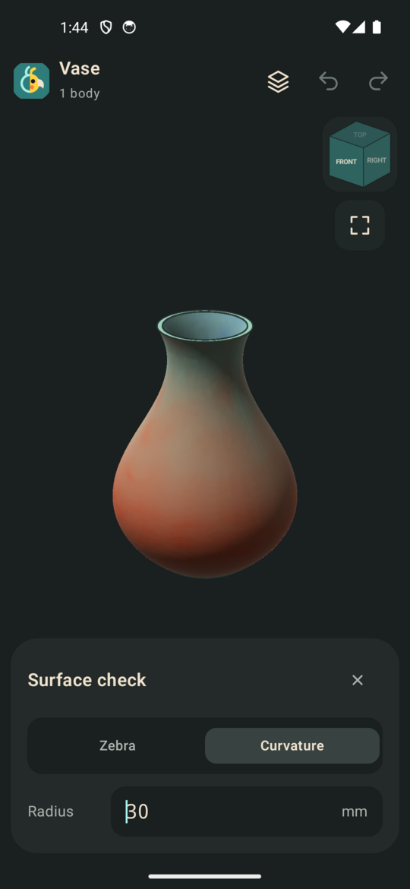
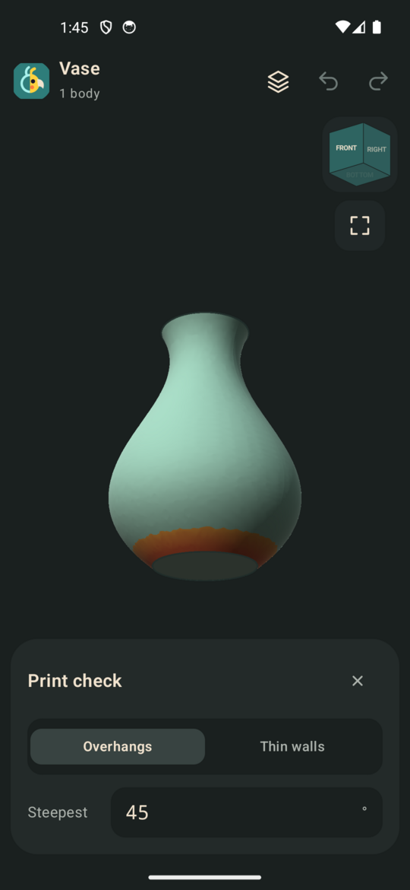

# ParrotMetric

ParrotMetric is a parametric 3D modeller for Android 8.1 or newer, Linux, Windows and browsers. Draw sketches, set their dimensions and turn them into solids. Each step stays in the history, so changing an earlier step rebuilds the ones after it. You can sculpt organic shapes too.

I made it for designing things to 3D print. It works with touch, a mouse or a keyboard, and runs on the device. You can use WebDAV to keep designs on a server.

It's usable for real parts, with rough edges still to fix. Let me know what works and what you'd like in #parrotmetric [on my discord](https://discord.gg/9Wun47jGC6), or open an issue here. The [manual](manual/README.md) is also under Help in the app.

Enjoy!
Dan

---

## Screenshots

<table>
  <tr>
    <td align="center"></td>
    <td align="center"></td>
    <td align="center"></td>
  </tr>
  <tr>
    <td align="center"></td>
    <td align="center"></td>
    <td align="center"></td>
  </tr>
</table>

The box has rounded corners, a hollow, vents and a lid on a hinge joint, with its sizes as parameters. The vase is a loft through four rings, hollowed out.

---

## What's in it

### Sketching

Draw lines, rectangles, circles, arcs, polygons, slots, ellipses, conics and splines. Add dimensions and constraints, or use expressions tied to named parameters. Colours and a count show what's still free to move.

Trim, extend, break, offset, round corners, mirror, move, scale and pattern sketches. Text can use the supplied fonts or a font file. Import SVG and DXF drawings, trace over pictures, and project edges or intersections from bodies.

### Solids and surfaces

Extrude, revolve, sweep, loft, pipe and coil sketches, or start with a box, cylinder, sphere, torus, cone or gear. Join, cut and intersect bodies. Add fillets, chamfers, shells, drafts, ribs, webs, holes, threads and fasteners, or emboss a sketch onto a face.

Move, scale, align, split, mirror and pattern bodies or history steps. Make surfaces from sketches, open profiles or edges, then trim, offset, stitch and thicken them.

### Meshes and sculpting

Import STL, 3MF and OBJ meshes, with repairs on the way in. Cut and combine them with solids, sketch on flat areas, reduce, remesh, smooth, hollow, erase, fill and separate them. Small meshes can be turned into solids.

Sculpt from a body, ball or block with draw, clay, crease, smooth, flatten, inflate, pinch, grab, pull, layer and mask brushes. Use symmetry, pen pressure and detail added under the brush. Sculpting stays in the history and is reapplied when an earlier step changes.

### Components and joints

Group bodies into components and insert other designs, kept up to date from their files. Name, colour, hide or isolate components, or make them see-through. Add rigid, turning or sliding joints and move them with sliders. There are exploded views and a bill of materials.

### Checking and drawings

Measure lengths, angles, areas, volume, centre of mass and weight in common print materials. Section views show the inside. Print checks find overhangs and thin walls, surface checks show zebra stripes and curvature, and interference checks find overlapping bodies.

Make drawing sheets with front, side, top, isometric and section views, dimensions, hole callouts, notes and title blocks. Export PDF at true size, DXF or SVG. Views and dimensions follow changes to the part.

### Parameters and configurations

Use named parameters in number fields. Configurations keep sets of values and enabled history steps, so you can switch between versions of a part.

### Files

- Its own design files (.pmet), which keep the whole history
- Export to STL, 3MF (with colours), OBJ, STEP and IGES, per body or all together, at coarse, medium or fine detail
- Open the part straight in Bambu Studio, OrcaSlicer, PrusaSlicer or Cura on a computer, or share it on Android
- Import STEP and IGES as solids you can keep working on
- A projects folder, so your designs are the same on every device: a folder a sync app looks after (Nextcloud, Syncthing and the like), or a folder on a WebDAV server such as Nextcloud. If a design was changed in two places at once, both versions are kept
- Autosave every 30 seconds, and whenever it goes to the background or closes, so a crash or a phone call doesn't lose your work
- Named versions kept in the design's file, to go back to
- Tap the design's name to rename it and its file
- A sketch saved as DXF, for a laser cutter

### Controls

- Touch: one finger turns the view, two pan and pinch to zoom, double tap fits everything, and a long press on a step in the history for its menu
- Mouse: middle drag pans, Shift and middle drag or right drag turns, the wheel zooms to the pointer, left drag box-selects (left to right picks what's inside, right to left picks anything it touches), right click for a menu with Repeat
- Keyboard: a letter for most tools, Ctrl (or Alt) for file and edit, Esc or Backspace to back out, digits go into the first field, Tab moves between fields and Enter finishes. Press S to search for a tool and ? for the list of keys. Key badges show on the buttons when a keyboard is attached
- Two layouts, one for phones and one for tablets, desktop and the browser, picked by the window size or set in Settings
- Display detail set from a quick speed test the first time it runs, so it stays smooth on older devices (it runs well on a Fire HD 8), and you can change it in Settings

---

## Keeping designs in sync

In Settings, under Projects folder, either choose a folder that a sync app keeps up to date, or enter a WebDAV server. Designs you make are saved there as .pmet files, and the start screen lists what's in it. When you come back to the app, it loads a newer copy if another device has changed the one you have open.

For Nextcloud, the folder address looks like `https://your.server/remote.php/dav/files/USERNAME/ParrotMetric/` (make the folder first), and it's best to use an app password from Nextcloud's security settings.

The browser version can only use a server that allows requests from the page's address (CORS). Most don't by default.

---

## Getting it

Each release has:

| File | For |
|---|---|
| parrotmetric-0.6.3-64bit.apk | Most Android phones and tablets |
| parrotmetric-0.6.3-32bit.apk | Older 32-bit devices, like the Fire HD 8 |
| parrotmetric_0.6.3_amd64.deb | Debian, Ubuntu and the like on a PC |
| parrotmetric_0.6.3_arm64.deb | Raspberry Pi OS (64-bit) and other arm64 Linux |
| parrotmetric-0.6.3-x86_64.AppImage | Any recent Linux on a PC |
| parrotmetric-0.6.3-aarch64.AppImage | Any recent arm64 Linux |
| parrotmetric-0.6.3-setup.exe | 64-bit Windows, installed |
| parrotmetric-0.6.3-windows-x64.zip | Windows, without installing |
| parrotmetric-0.6.3-web.tar.gz | The browser version, to put on any web server |

The AppImages and the Windows builds bring their own Java. The .deb packages use the system's Java 21, which your package manager pulls in.

---

## Building

Get the submodules first:

    git submodule update --init --depth 1

Each target builds Open CASCADE for itself the first time, which takes a while. It's kept in core/build/occt and reused after that.

Android, 64-bit (arm64), and with -Parm32 the 32-bit build (armv7). Debug builds add x86_64 or x86, for emulators:

    ./gradlew :app:assembleRelease
    ./gradlew :app:assembleRelease -Parm32

Release builds are signed with the key named in ../Keys/parrotmetric-keystore.properties, when there is one.

Desktop, on the machine you're on:

    ./gradlew :desktop:run

The packages are built in Docker containers (desktop/native/Dockerfile.*):

    ./gradlew :desktop:debAmd64 :desktop:debArm64
    ./gradlew :desktop:appImageAmd64 :desktop:appImageArm64
    ./gradlew :desktop:windowsX64

The browser build needs Emscripten (emsdk, in ~/.local/share/emsdk or wherever EMSDK says):

    ./gradlew :webApp:wasmJsBrowserDistribution

The page ends up in web/app/build/dist/wasmJs/productionExecutable. If you change NativeCore.kt, run web/core/gen_bridge.py to update the browser's side of the calls.

The core's tests run on the build machine:

    core/scripts/build-occt.sh host
    cmake -S core -B core/build/host -G Ninja -DPM_TESTS=ON
    cmake --build core/build/host
    ctest --test-dir core/build/host

and the rest with:

    ./gradlew :model:jvmTest :shared:desktopTest

---

## Thanks

ParrotMetric uses these libraries and tools for modelling, drawing and the app. Their authors did much of the work it relies on.

- [Open CASCADE Technology](https://dev.opencascade.org/) 8.0.1 does the solid modelling: booleans, fillets, sweeps, offsets, STEP and IGES, and the meshing for display and export. LGPL 2.1 with the Open CASCADE exception.
- [Manifold](https://github.com/elalish/manifold) 3.5.4 does the mesh bodies and their booleans, and the reduce and smooth tools. Apache 2.0.
- [Eigen](https://eigen.tuxfamily.org/) 5.0.1 does the maths in the sketch solver. MPL 2.0.
- [zlib](https://zlib.net/) 1.3.1 reads and writes 3MF files on desktop and in the browser. zlib licence.
- [stb_truetype and stb_image](https://github.com/nothings/stb) by Sean Barrett turn fonts into outlines and read pictures for canvases. MIT or public domain.
- [Noto Sans](https://fonts.google.com/noto/specimen/Noto+Sans), [DejaVu Serif](https://dejavu-fonts.github.io/), [Hack](https://sourcefoundry.org/hack/) and [Quicksand](https://github.com/andrew-paglinawan/QuicksandFamily) are the fonts for text in sketches, the last three cut down to Latin letters. SIL Open Font License 1.1 (Noto Sans and Quicksand), the Bitstream Vera licence (DejaVu) and MIT with the Bitstream Vera licence (Hack); the licences are in third_party/fonts/licences.
- [Catch2](https://github.com/catchorg/Catch2) runs the core's tests (not part of the app). Boost Software License.
- The OpenGL ES and EGL headers are the [Khronos Group](https://www.khronos.org/)'s, under the MIT and Apache 2.0 licences in each file.
- The app is written in [Kotlin](https://kotlinlang.org/) with [Compose Multiplatform](https://www.jetbrains.com/compose-multiplatform/) by JetBrains, and uses AndroidX and kotlinx.coroutines (Apache 2.0).
- [OkHttp](https://square.github.io/okhttp/) by Square talks to WebDAV servers in the Android app. Apache 2.0.
- The browser build is made with [Emscripten](https://emscripten.org/) and [Binaryen](https://github.com/WebAssembly/binaryen).

Their licences are in [licences/](licences/), and their sources are in third_party/ as git submodules, apart from stb and the fonts, which are kept in the repository. If you got ParrotMetric as an app, the same licences come with it.

---

## Licence

ParrotMetric is under the GPL 3. See [LICENSE](LICENSE).

Disclaimer: I am not a great programmer so this was made using Claude Opus 5.5
